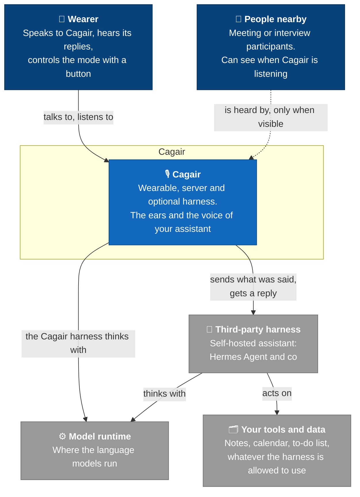
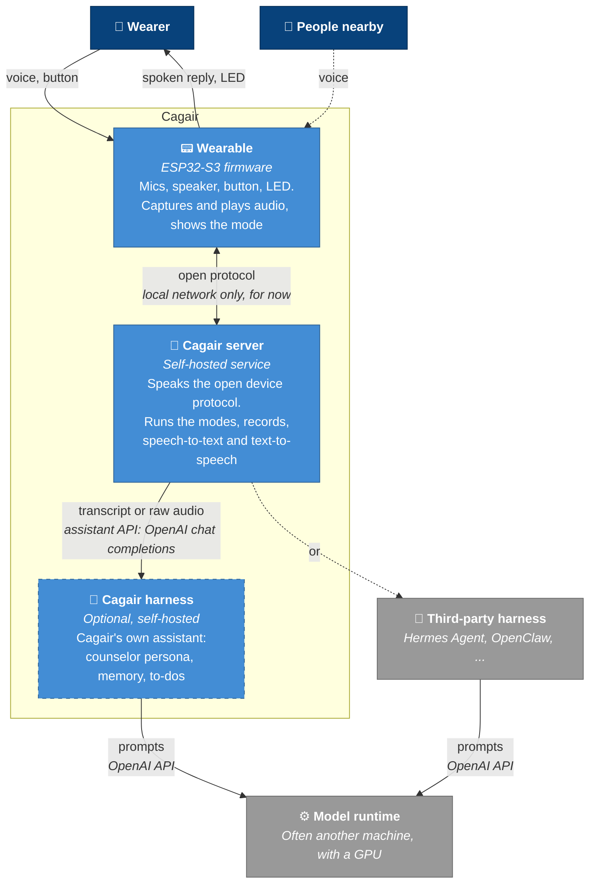

# Cagair architecture (C4 model)

> **Status: vision draft.** Nothing here is built yet. This describes where Cagair is heading, at the two highest levels of the [C4 model](https://c4model.com): **system context (C1)** and **containers (C2)**. Component and code levels are left out on purpose until there is code to describe.

## Vocabulary

- **Cagair server**: the self-hosted service the wearable talks to. It receives audio, handles the modes, and owns speech-to-text and text-to-speech. It calls an assistant, never a model directly.
- **Harness** (or **assistant**): the software that thinks. It receives what was said, calls the model, uses tools and memory, and answers. It can be the optional **Cagair harness** or a third-party one such as Hermes Agent.
- **Model runtime**: where the models behind the harness run, often on another machine with a GPU.

## C1: System context

Who uses Cagair, and what it talks to.

**Reading it:** Cagair owns the device and the voice pipeline. The thinking happens in a harness you choose, and the models run wherever you run them. Nothing in this picture is a vendor cloud.

## C2: Containers

What Cagair is made of, and where each part runs.

| Container | Runs on | Responsibility |
| --- | --- | --- |
| **Wearable** | ESP32-S3, on you | Capture and play audio, show clearly when it is listening, recording or off. Stays dumb on purpose: no assistant logic lives here. |
| **Cagair server** | A machine you own (home server, NAS, laptop) | The only thing the wearable talks to. Speaks the open protocol, runs the modes, records, and owns speech-to-text and text-to-speech. It decides, per mode, whether and when to call the harness, and never calls a model directly. |
| **Cagair harness** *(optional)* | A machine you own, often the same as the server | Cagair's own assistant: the counselor persona, memory, summaries and to-dos. Skip it and point the server at another harness instead. |
| **Third-party harness** *(external)* | Wherever you run it | Hermes Agent and similar. Swappable with the Cagair harness because both sit behind the same assistant API. |
| **Model runtime** *(external)* | Often a separate machine with a GPU | Serves the models the harness calls. Cagair does not ship models, it connects to ones you run. |

### How the modes use the containers

The server does not forward every word straight to the harness. Each mode decides what reaches it, and when:

| Mode | What the server does | What reaches the harness |
| --- | --- | --- |
| **Wake word** | Transcribes the command after the wake word, speaks the reply. | One request per command. |
| **Meeting / interview** | Records the whole conversation, with no live calls, so recording never waits on the harness. Transcribes at the end. | The full transcript once, asking for a summary and to-dos. |
| **Active assistant** | Listens continuously; a light filter decides to act, record or ignore. | Only what the filter decides to act on. |
| **Off** | Nothing. The microphones are off. | Nothing. |

### Transcript or raw audio

What the server sends to the harness is a **configuration of your setup**, chosen by what your harness can accept:

- **Transcript (default).** The server runs speech-to-text and sends text. This works with any harness, since every one of them accepts text.
- **Raw audio.** The server sends the audio itself, for a harness and model that can listen directly, which keeps tone and hesitations the transcript loses. The OpenAI chat completions format allows audio parts in a message, but only audio-capable models understand them, and few self-hosted harnesses pass them through today (Hermes Agent, for example, takes text only).

Either way, the reply comes back as text, and the server turns it into speech for the wearable.

### Local network only, for now

**The first milestone supports the local network only.** The wearable and the server sit on the same Wi-Fi, and nothing is exposed to the internet. Working away from home is deferred until the connection can be secured with confidence.

Notes for when it comes back:

- **Tailscale is the preferred direction** for reaching the server from outside.
- **The wearable cannot simply join a tailnet.** There is no official Tailscale client for microcontrollers. Community ports for the ESP32-S3 exist ([MicroLink](https://components.espressif.com/components/fugo101/microlink), for example), but they are young, and one [voice experiment on an ESP32-S3](https://lilting.ch/en/articles/m5stack-cores3-tailscale-direct-voice-server) found them too slow for live voice through Tailscale's relays.
- **A plain phone hotspot is not enough on its own.** Devices tethered to a phone generally do not go through the phone's VPN.
- **Candidates:** a phone hotspot plus [Tailscale Funnel](https://tailscale.com/kb/1223/funnel) (a public HTTPS address, so it needs solid device authentication), or Tailscale on the wearable once the ports mature. A phone relay app has been ruled out.

Two rules from today keep that door open:

1. **One protocol.** The wearable speaks the same device protocol whatever the network path. Only the address would change.
2. **The device authenticates itself.** Even on the local network, the wearable proves who it is to the server with its own key or token, so the network is never the only protection.

### The two APIs behind the server

**Harness to model: the OpenAI API (decided).** The harness calls the model runtime through the OpenAI-compatible API, which Ollama, llama.cpp, vLLM and most other runtimes already serve. Any model you can run behind that API works.

**Server to harness: OpenAI chat completions too (proposed).** The Cagair server is just another OpenAI-compatible client, and the harness looks to it like a model endpoint. This is the only API that third-party harnesses such as Hermes Agent already expose, so swapping the harness means changing a URL, a key and a model name, nothing else.

How Cagair uses it:

- **One request per turn.** The server sends the transcript as a user message and keeps the conversation history, or lets the harness keep it where the harness supports sessions.
- **Streaming replies.** The server asks for a streamed answer and starts speaking at the first full sentence, so the wearable does not wait for the whole reply.
- **Raw audio when configured.** For an audio-capable harness, the server sends an `input_audio` part in the message instead of the transcript.
- **Meeting mode is a single request.** The full transcript goes in with an instruction asking for a summary and to-dos. Where the harness supports structured output, the server asks for JSON; otherwise it reads plain text.
- **The Cagair harness speaks the same API.** It may accept optional extra fields, such as the mode and timestamps, that other harnesses simply ignore. Nothing Cagair needs depends on them.

**Two seams make Cagair open:**

1. **Device protocol** (wearable ↔ server). Documented, so anyone can replace the Cagair server with their own stack.
2. **Assistant API** (server ↔ harness). OpenAI chat completions: transcript or audio in, text out, so the brain can be swapped without touching the device.

## Open questions

These are the decisions this draft does not settle yet.

1. **Is chat completions enough between server and harness?** Proposed above. The risk is that it has no standard way to say "this is a meeting, not a command" or to let the harness speak first (a reminder, for example). That may need a small Cagair extension later.
2. **Where does the "act, record or ignore" filter live?** On the wearable (more private, less capable), in the server (drawn here), or in the harness.
3. **Does the server keep data?** Recordings, transcripts and to-dos have to live somewhere. That may be another container (a data store) owned by the server, or it may belong to the harness.
4. **How to work away from home securely?** Deferred until after the first milestone; see [Local network only, for now](#local-network-only-for-now).
5. **People nearby.** They are part of the system context. How the design respects them (visible LED, an audible cue, a meeting-mode consent step) is a principle, but not yet a design.
