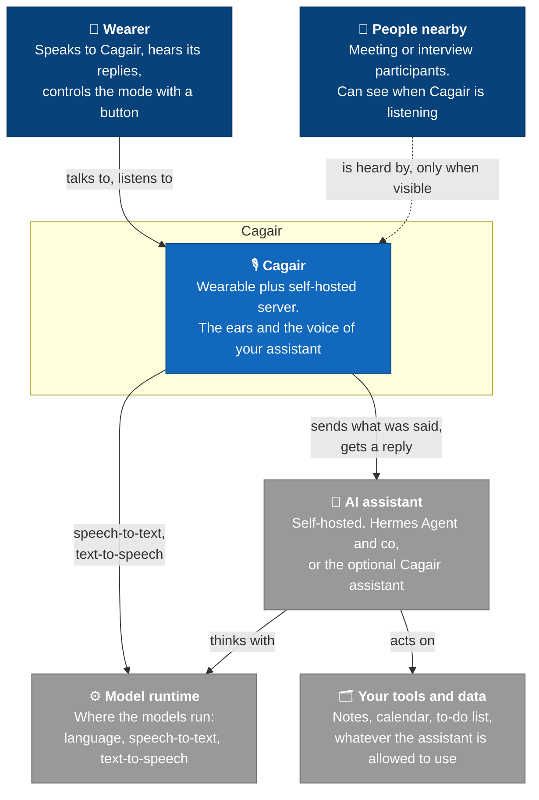
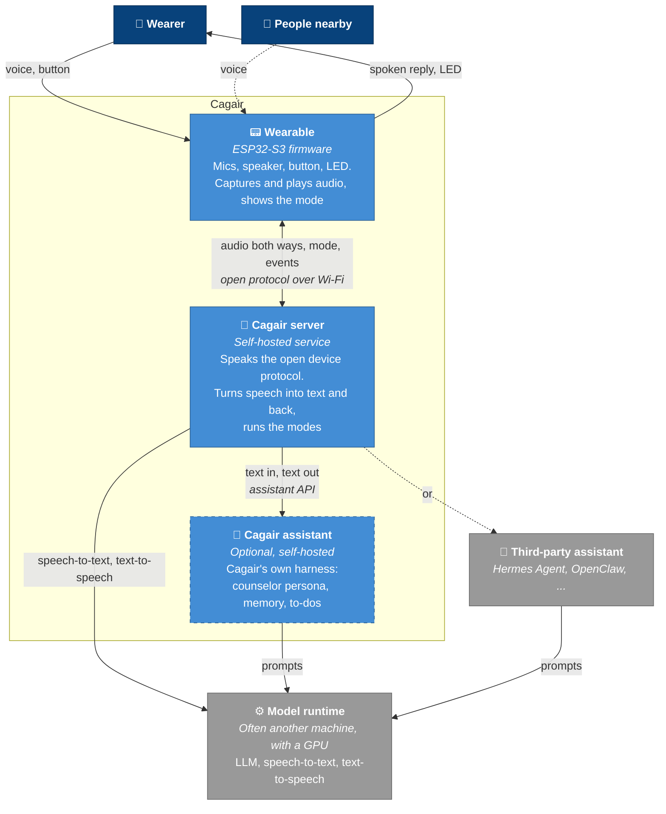

# Cagair architecture (C4 model)

> **Status: vision draft.** Nothing here is built yet. This describes where Cagair is heading, at the two highest levels of the [C4 model](https://c4model.com): **system context (C1)** and **containers (C2)**. Component and code levels are left out on purpose until there is code to describe.

## C1: System context

Who uses Cagair, and what it talks to.

**Reading it:** Cagair is deliberately small. It owns the device and the voice pipeline, and treats the assistant and the models as things *you* already run, or choose to run. Nothing in this picture is a vendor cloud.

## C2: Containers

What Cagair is made of, and where each part runs.

| Container | Runs on | Responsibility |
| --- | --- | --- |
| **Wearable** | ESP32-S3, on you | Capture and play audio, show clearly when it is listening, recording or off. Stays dumb on purpose: no assistant logic lives here. |
| **Cagair server** | A machine you own (home server, NAS, laptop) | The only thing the wearable talks to. Speaks the open protocol, turns speech into text and the reply back into speech, and runs the modes (wake word handling, meeting recording, the "act, record or ignore" filter). |
| **Cagair assistant** *(optional)* | A machine you own, often the same as the server | Cagair's own harness: the counselor persona, memory, summaries and to-dos. Skip it and point the server at another assistant instead. |
| **Third-party assistant** *(external)* | Wherever you run it | Hermes Agent and similar. Swappable with the Cagair assistant because both sit behind the same assistant API. |
| **Model runtime** *(external)* | Often a separate machine with a GPU | Serves the models. Cagair does not ship models, it connects to ones you run. |

**Two seams make Cagair open:**

1. **Device protocol** (wearable ↔ server). Documented, so anyone can replace the Cagair server with their own stack.
2. **Assistant API** (server ↔ assistant). Text in, text out, so the brain can be swapped without touching the device.

## Open questions

These are the decisions this draft does not settle yet.

1. **Is the server separate from the assistant?** This draft splits them: the server owns voice and modes, the assistant owns thinking. The README currently calls the voice part "the harness"; the naming should be settled and the README aligned.
2. **Where do speech-to-text and text-to-speech run?** Drawn here as models in the model runtime, called by the server. They could instead run inside the server itself for a single-box setup.
3. **Which assistant API?** OpenAI-compatible chat completions is the common denominator today (Hermes Agent exposes it). Meeting mode may need more than chat, such as sending a long transcript and getting a summary and to-dos back.
4. **Where does the "act, record or ignore" filter live?** On the wearable (more private, less capable), in the server (drawn here), or in the assistant.
5. **Does the server keep data?** Recordings, transcripts and to-dos have to live somewhere. That may be a sixth container (a data store) owned by the server, or it may belong to the assistant.
6. **What happens away from home Wi-Fi?** A wearable leaves the house. Options include a phone hotspot, a phone app as relay, or a VPN back to your server. This could add a container.
7. **People nearby.** They are part of the system context. How the design respects them (visible LED, an audible cue, a meeting-mode consent step) is a principle, but not yet a design.
